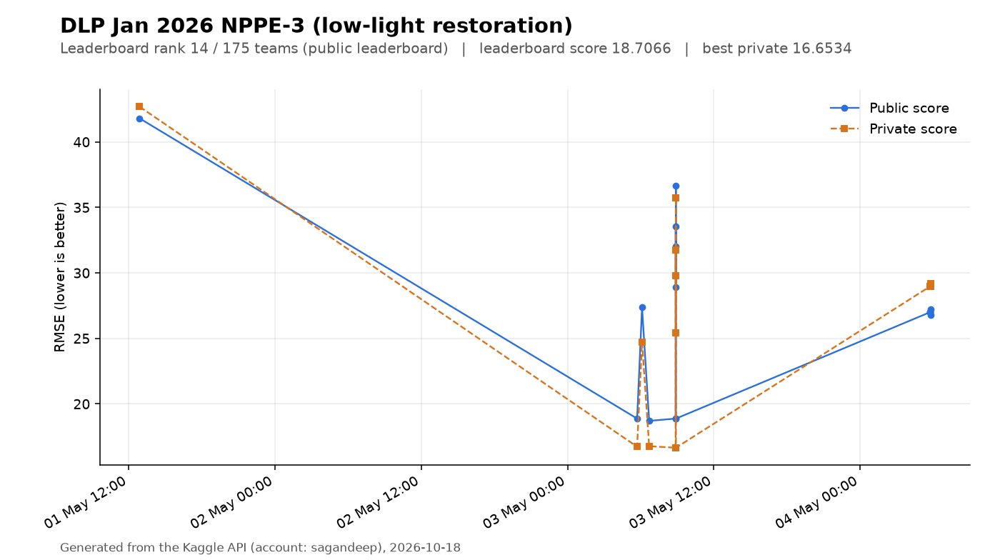
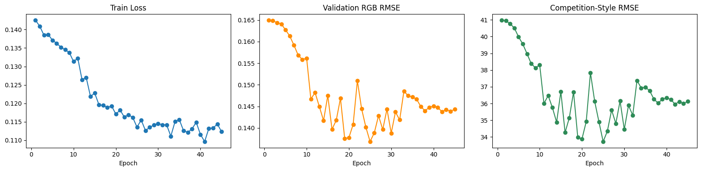
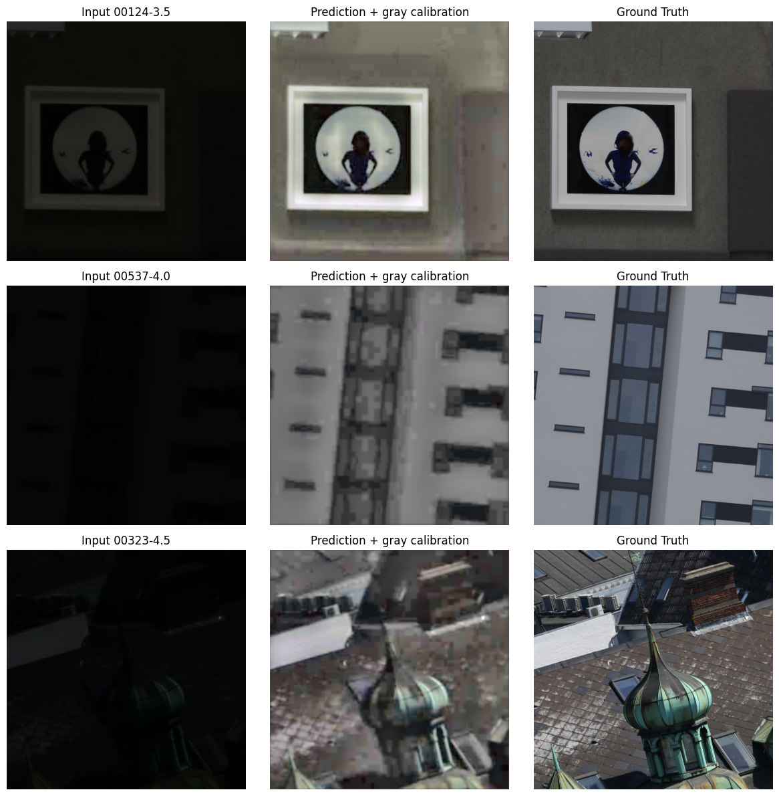

# Low-Light Image Restoration: Denoising and 4× Super-Resolution

An iterative computer-vision project for the [DLP January 2026 NPPE-3 Kaggle competition](https://www.kaggle.com/competitions/dlp-jan-2026-nppe-3). The notebooks explore joint low-light denoising, illumination correction, and 4× super-resolution on paired low-/high-resolution images.

## Project at a glance

- Built a U-Net-style super-resolution model with a PixelShuffle upsampling head and residual refinement.
- Compared Charbonnier, grayscale, and edge-aware objectives.
- Added mixed precision, cosine learning-rate scheduling, test-time augmentation, gray calibration, scene-aware validation, and sampled-pixel predictors across six iterations.
- Preserved executed notebooks and the full experiment log so results can be audited.

## Recorded competition results

Lower RMSE is better. The public scores below are the values recorded in [`logs.md`](logs.md); the private scores were added from the Kaggle API (queried 2026-10-18) and match the corresponding submissions by file name (`submission_N.csv`).

| Submission | Main iteration | Public RMSE | Private RMSE |
|---|---|---:|---:|
| 1 | Initial SRUNet baseline | 41.80 | 42.69 |
| 2 | Larger model + test-time augmentation | 18.88 | 16.73 |
| 3 | Scene-prior experiment | 27.37 | 24.71 |
| 4 | Refined SR model and calibration experiments | **18.71** | 16.77 |
| 5 | Model/KNN candidate comparison | 18.88 | **16.65** |
| 6 | Scene-grouped validation + direct sampled-pixel model | 27.00 | 28.97 |

The best **public** score is **18.71 (submission 4)**, which is what the public leaderboard ranks. The best **private** score is 16.65 (submission 5), with submissions 2 and 4 within 0.12 of it. Iteration 6 is the latest notebook, but it is an experiment aimed at matching the sampled-pixel competition objective; it is not the best result on either split.

## Kaggle results

Figures below come from the Kaggle API (account `sagandeep`, queried 2026-10-18) for the [DLP January 2026 NPPE-3](https://www.kaggle.com/competitions/dlp-jan-2026-nppe-3) competition.

- **Leaderboard rank: 14 of 175 teams** (public leaderboard; the API does not expose a private-leaderboard ranking), with a score of 18.70658 RMSE (lower is better).
- Best private score: 16.65338 RMSE.
- Which submission was selected as final is not exposed by the API, so the table above reports both splits.



*Results chart generated from the Kaggle API (not a screenshot): scored submissions over time.*

Stored output from the committed iteration-4 notebook ([`train-codex-v4.ipynb`](train-codex-v4.ipynb)): training curves and sample predictions with gray calibration. The notebook's "competition-style RMSE" on its own validation split is not the same quantity as the leaderboard RMSE.





## Model path

```text
low-light 312×312 RGB
        │
        ▼
U-Net encoder / decoder
        │
        ▼
PixelShuffle 4× upsampling
        │
        ├── bilinear residual skip
        └── convolutional refinement
        ▼
restored ~1250×1250 RGB
```

The final notebook also trains a compact direct model for the 100 grayscale sample locations used by the competition submission format. This is a competition-specific branch, separate from full-image perceptual restoration.

## Notebooks

| Notebook | Purpose |
|---|---|
| [`kaggle-eda.ipynb`](kaggle-eda.ipynb) | Image sizes, intensity mappings, noise, and scene relationships |
| [`train-codex-v1.ipynb`](train-codex-v1.ipynb) | Initial SRUNet baseline |
| [`train-codex-v2.ipynb`](train-codex-v2.ipynb) | Larger architecture and TTA |
| [`train-codex-v3.ipynb`](train-codex-v3.ipynb) | Scene-prior experiment |
| [`train-codex-v4.ipynb`](train-codex-v4.ipynb) | Best recorded competition result |
| [`train-codex-v5.ipynb`](train-codex-v5.ipynb) | Model and nearest-neighbour candidate comparison |
| [`train-codex-v6.ipynb`](train-codex-v6.ipynb) | Scene-grouped validation and direct sampled-pixel training |

## Reproduce on Kaggle

The notebooks are self-contained and use Kaggle paths. To reproduce an iteration:

1. Join the competition and create a Kaggle notebook with GPU acceleration.
2. Attach the `dlp-jan-2026-nppe-3` competition dataset.
3. Upload or import the chosen notebook from this repository.
4. Run the notebook top to bottom.
5. Download the generated `submission.csv` and artifacts from `/kaggle/working/nppe3_outputs/`.

The main Python dependencies are PyTorch, NumPy, pandas, Pillow, Matplotlib, and scikit-learn. The notebooks detect CUDA and use automatic mixed precision where configured.

Expected competition layout:

```text
/kaggle/input/competitions/dlp-jan-2026-nppe-3/
├── train/train/input/
├── train/train/ground_truth/
├── test/test/input/
└── sample_submission.csv
```

## Reproducibility notes

- Random seeds are fixed to 42 in the later notebooks.
- Iteration 6 asserts 1,200 paired training images and uses a scene-grouped 10% validation split to avoid placing exposures from the same scene in train and validation.
- The notebooks write checkpoints, predictions, and submissions to Kaggle's working directory; those large generated files are not committed here.
- [`logs.md`](logs.md) records configurations, epoch logs, candidate comparisons, and submission scores.

## Limitations

- The best numbers are competition RMSEs, not a general perceptual-quality benchmark.
- Some earlier validation strategies used related exposures from the same scene and were optimistic; the later scene-grouped split addresses this explicitly.
- Scene priors and sampled-pixel optimization exploit this competition's data and scoring structure and may not transfer to ordinary image restoration.
- There is no standalone package or pretrained checkpoint in the repository; reproduction requires the Kaggle dataset and substantial GPU compute.
- The figures in this README are stored outputs from the executed notebook and the Kaggle API; no synthetic examples are shown.
